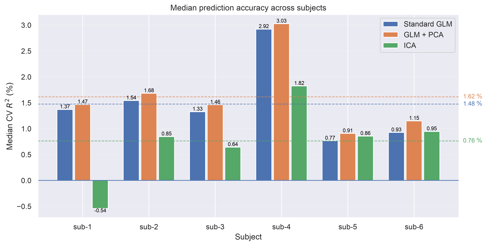
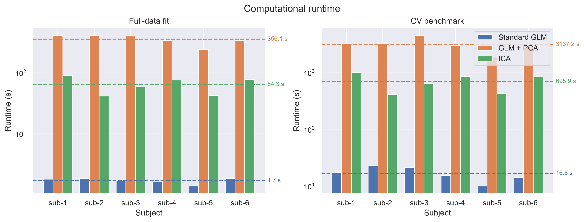
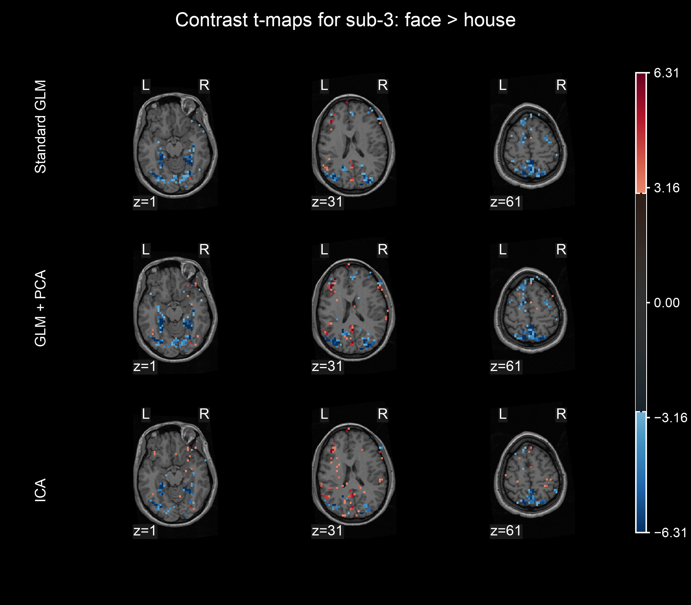

# fMRI Denoising with Statistical Models

My master's thesis project comparing three statistical approaches to denoising task-based functional MRI (fMRI): **standard General Linear Model (GLM), PCA-assisted GLM, and Independent Component Analysis (ICA)**.

The project combines statistical modeling, time-series analysis, dimensionality reduction, cross-validation, and computational benchmarking to investigate how different denoising strategies affect the estimation of task-related brain activity.

**Dataset:** [Visual Object Recognition (OpenNeuro ds000105)](https://openneuro.org/datasets/ds000105)

## Key findings

- **PCA-assisted GLM had the highest CV prediction accuracy for all six participants**.
- **Standard GLM -- the best trade-off between accuracy and computational cost.**
- **ICA-based denoising performed worse than standard GLM for four of the six participants.**

Main conclusions from the analysis showed, that **more elaborate denoising does not automatically produce meaningfully better results**, or more conscisely: more math, does not equal better math.

## Results at a glance

| Method | Mean per-subject median outer-CV \(R^2\) | Mean full-data fitting time | Mean outer-CV runtime |
| --- | ---: | ---: | ---: |
| Standard GLM | 1.48% | **1.7 s** | 16.8 s |
| PCA-assisted GLM | **1.62%** | 356.1 s | 3,137.2 s |
| ICA-based denoising | 0.76% | 64.3 s | 695.9 s |

### Selected results

**Cross-validated prediction accuracy**



*PCA-assisted GLM achieved the highest median prediction accuracy for every participant, although the improvement over standard GLM was small.*

**Computational cost.**



*The additional model selection and component-analysis steps substantially increased runtime without delivering a proportional improvement in predictive performance.*

**Face-versus-house contrast t-maps**



*Contrast t-maps for participant 3, showing the face > house comparison. Standard GLM and PCA-assisted GLM produce similar spatial patterns; ICA-based denoising introduces more noticeable differences.*

## Detailed findings

The outer leave-one-run-out CV results showed that PCA-assisted GLM produces consistent (and small) improvement in task-response prediction. The median $R^2$ values per participant was $1.62\%$ for this method, compared with $1.48\%$ for standard GLM. The improvement did not translate into consistently more stable beta coefficients, measured by jackknife signal-to-noise ratio.

Standard GLM achieved very similar predictive performance, while being much less computationally heavy, making it the most favorable overall trade-off in this analysis, as well as a strong comparative baseline.

ICA-based denoising had the smalles mean median $R^2$ of $0.76\%$, with poor results for subjects 1-4 and small improvements over standard GLM for participants 5 and 6. Its results additionally showed greater subject dependence and differences in the estimated spatial patterns. The possible explanations include uncertain component classification and the absence of explicit pre-processing motion correction.

## Methods

### 1. Standard GLM

The baseline model estimates task-related BOLD responses using a General Linear Model. Task regressors are constructed by convolving stimulus timing with a canonical haemodynamic response function (HRF). An intercept and discrete cosine transform (DCT) regressors account for low-frequency drift.

Regression coefficients are estimated using **Feasible Generalized Least Squares (FGLS)** with a run-specific AR(1) temporal covariance model and prewhitening.

### 2. PCA-assisted GLM

Inspired by GLMdenoise, this method extends the baseline model with data-derived nuisance regressors.

1. Fit the baseline GLM and identify a noise pool using inner CV task-prediction accuracy and a mean-signal criterion.
2. Apply PCA to the detrended noise-pool time series for each run.
3. Select the number of components through inner LORO CV, using a 95%-of-maximum-improvement rule and a maximum of 20 components.
4. Refit the GLM with the selected principal components as additional nuisance regressors.

This approach tests whether structured variability captured directly from the data can improve estimation of task-related responses.

### 3. ICA-based denoising

The ICA pipeline uses probabilistic PCA and Bayesian model-order selection to determine a reduced-dimensional representation, followed by whitening and FastICA to estimate independent components.

A permutation-based procedure classifies components as task-related or nuisance. The nuisance contribution is reconstructed and subtracted from the data, after which task-related responses are estimated using the same FGLS framework as the other methods.

This provides a comparison between regression-based nuisance modeling and denoising based on estimated independent components.

## Evaluation

All three approaches are evaluated using a common **leave-one-run-out cross-validation framework**. For each fold, one functional run is held out for testing while the remaining runs are used to estimate the model. This evaluates prediction on data not used during fitting.

The comparison includes:

- **Predictive performance:** voxelwise CV \(R^2\), including changes relative to the standard GLM.
- **Coefficient stability:** jackknife SNR of task-related estimates across training sets.
- **Spatial interpretation:** task-related beta maps and face-versus-house contrast \(t\)-maps.
- **Computational efficiency:** full-data fitting time and total outer-CV runtime.

The dataset contains six participants performing a one-back repetition-detection task involving eight visual categories. Each participant has 11 or 12 functional runs, with 121 time points per run.

Because the dataset does not provide a noise-free reference signal, denoising quality is assessed indirectly through predictive performance, estimate stability, and spatial patterns rather than direct comparison against ground-truth clean images.

## Tech focus

**Statistical modeling · Linear algebra · Time-series analysis · PCA and ICA · Cross-validation · Model selection · Numerical computation · Data visualization**

## Repository structure

```text
fmri-denoising/
├── general_linear_model/             # Standard and PCA-assisted GLM
├── independent_component_analysis/   # ICA-based denoising
├── evaluation/                       # Metrics, maps, and comparisons
├── utils/                            # Data loading and utilities
├── thesis/                           # Master's thesis source code
├── main.py                           # Pipelines and evaluation
└── plot_results.py                   # Result visualization
```

## Usage

Place the OpenNeuro dataset under `data/ds000105`, then run the desired pipeline.

```bash
# GLM + PCA-assisted denoising for one participant
python main.py --subject sub-1 --run_glm

# ICA-based denoising
python main.py --subject sub-1 --run_ica --ica_threshold 0

# Run the comparison and evaluation for one participant
python main.py --subject sub-1 --evaluate

# Generate figures
python plot_results.py --individual
python plot_results.py --group
python plot_results.py --components
```

Results are serialized under `results/` (not included in the repo), with generated plots stored in `results/plots/`.

## Limitations and scope

This is an academic research implementation built for a master's thesis, definitely not a production-ready neuroimaging package. The analysis is limited to six participants and one visual block-design experiment. Explicit motion correction and regressors derived from external physiological recordings were not included in the dataset, thus also not included in the models.
These limitations, together with the component-selection procedures, matter when interpreting the results or generalizing them to other fMRI experiments.
